<div align="center">


# Pixel Art Video

**把任何视频变成像素画、花朵马赛克或 ASCII 艺术，加上专属留言并分享出去。**

[](https://github.com/noms6/pixel-art-video/actions/workflows/test.yml) [](https://github.com/noms6/pixel-art-video/releases/latest) [](https://github.com/noms6/pixel-art-video/releases/latest)  [](../../LICENSE)

🌐 [English](../../README.md) · [Türkçe](README.tr.md) · [Deutsch](README.de.md) · [Français](README.fr.md) · [Español](README.es.md) · [Italiano](README.it.md) · [Português](README.pt.md) · [Nederlands](README.nl.md) · [Polski](README.pl.md) · [Română](README.ro.md) · [Svenska](README.sv.md) · [Ελληνικά](README.el.md) · [Русский](README.ru.md) · [Українська](README.uk.md) · [Azərbaycanca](README.az.md) · [العربية](README.ar.md) · [فارسی](README.fa.md) · [हिन्दी](README.hi.md) · [日本語](README.ja.md) · [한국어](README.ko.md) · **中文** · [Bahasa Indonesia](README.id.md) · [Tiếng Việt](README.vi.md) · [ไทย](README.th.md)

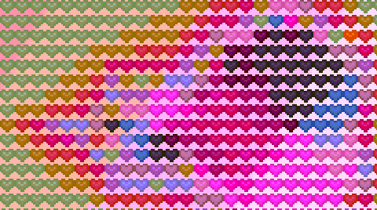 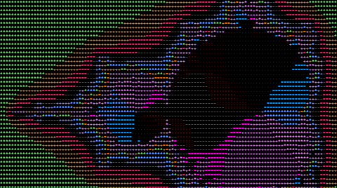

</div>

## ✨ 功能

- 速度快：1 分钟的 1080p 视频约 7 秒完成转换
- 支持常见格式：MP4、MOV、WebM、AVI、MKV、WMV、FLV 等（最大 500 MB）
- 28 种风格：普通像素画、花朵、爱心、形状、LED、ASCII 和盲文点阵
- 调色板（自动、Game Boy、PICO-8、CGA、复古棕…）、抖动、亮度/对比度、片段截取
- 按原速导出 MP4/WebM 视频，或导出为无限循环的 GIF
- 保存带留言和打字机效果的单文件网页（100–500 KB，可离线打开）
- 支持 24 种语言，根据浏览器自动选择
- 完全在你的电脑上运行——视频不会上传到任何地方

## 📥 下载（Windows）

1. 从[最新版本](https://github.com/noms6/pixel-art-video/releases/latest)下载 `PixelArtVideo-Windows-x64.zip`。
2. 解压后运行 `VideoASCIIArtConverter.exe`，浏览器会自动打开。无需安装 Python。

> 如果 Windows SmartScreen 弹出警告，请点击 **更多信息 → 仍要运行**（该应用未进行代码签名）。

## 🖼️ 截图

| | |
|---|---|
| 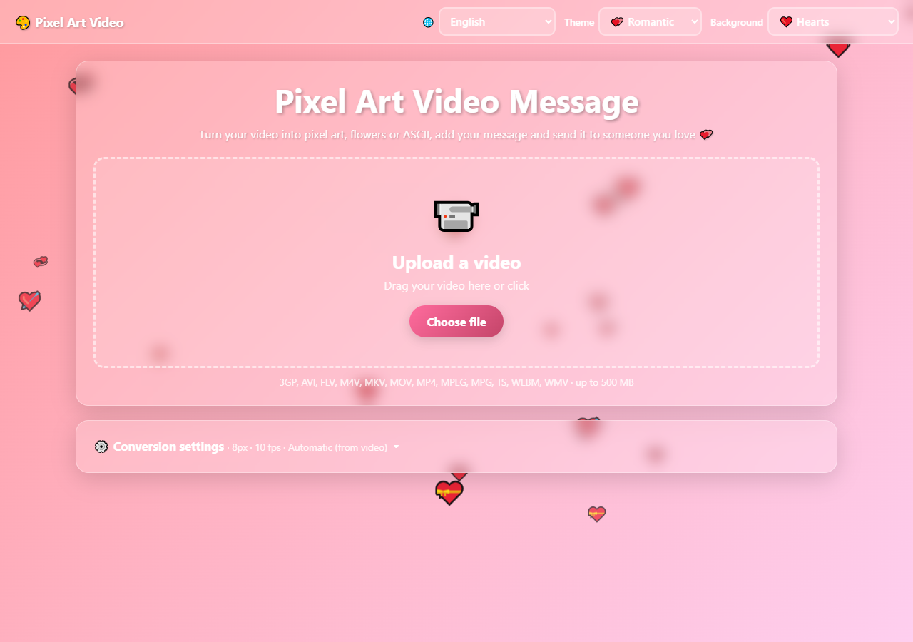<br>上传视频 | 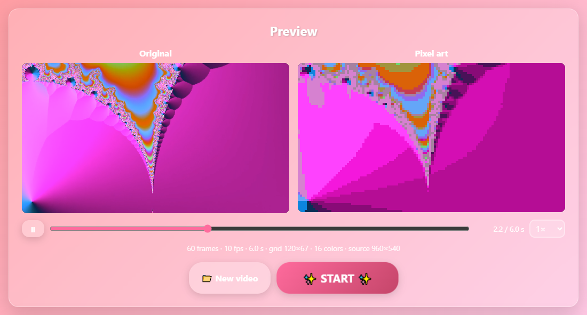<br>原视频与像素画对比 |
| 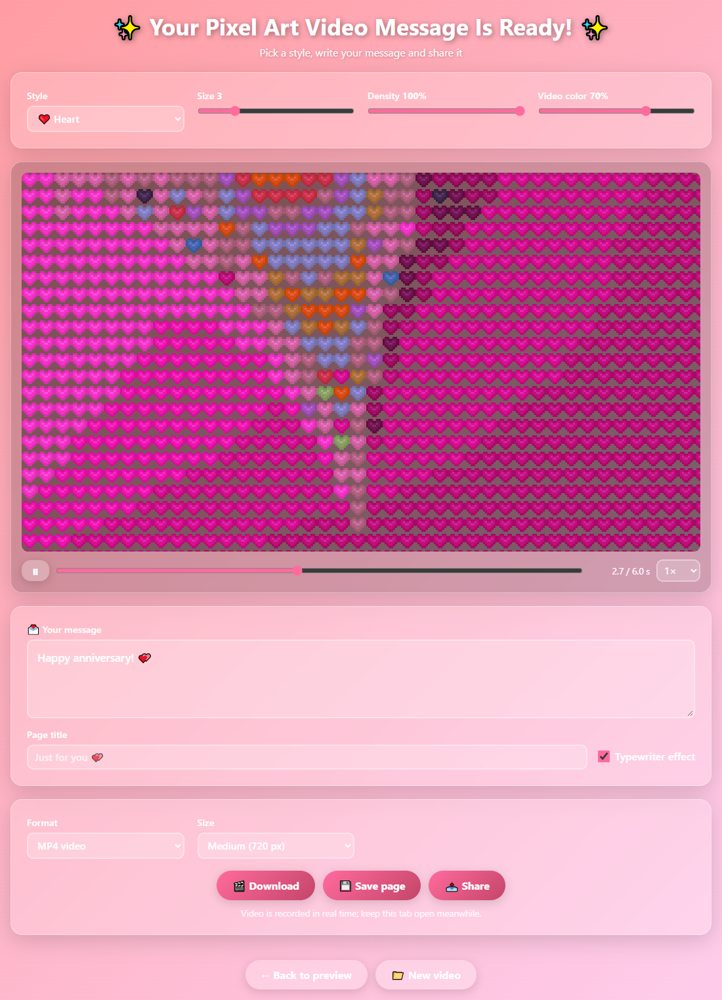<br>选择风格并写下留言 | 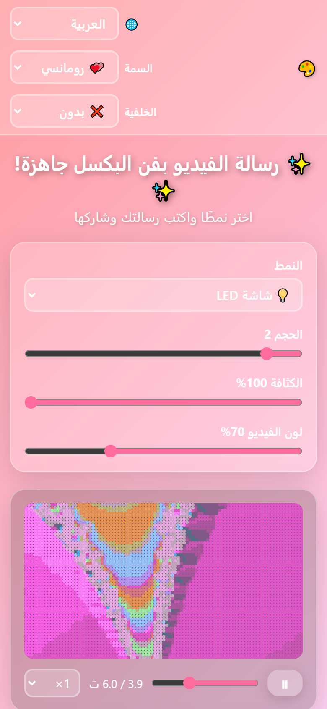<br>手机端，从右到左的语言 |

## 🎨 风格

| | | |
|---|---|---|
| <br>像素画 | 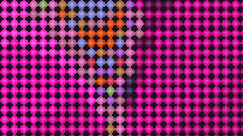<br>玫瑰 | 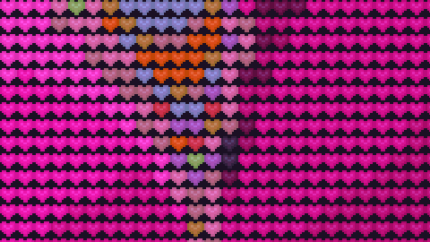<br>爱心 |
| 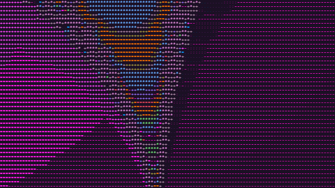<br>ASCII | 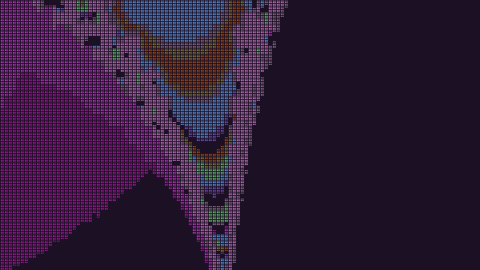<br>盲文点阵 | 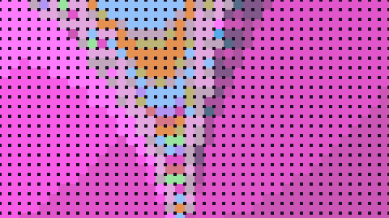<br>LED 屏幕 |

## 🧭 使用方法

1. 上传视频（拖放或选择文件）。也可以先打开转换设置。
2. 查看预览。修改设置后无需重新上传即可再次转换。
3. 点击 ✨ 开始 ✨，选择风格并调整大小、密度和颜色。
4. 写下留言，然后下载视频或 GIF、保存网页或分享。

## 🚀 从源代码运行

```bash
pip install -r requirements.txt
python start_app.py
```

## 🛠️ 开发

架构、API、测试和翻译指南请参阅[主 README](../../README.md#development)。

## 📜 许可证

[MIT](../../LICENSE) © noms6

Windows 版本包含以下开源组件： [OpenCV](https://opencv.org) (Apache 2.0) + [FFmpeg](https://ffmpeg.org) (LGPL 2.1) · [NumPy](https://numpy.org) (BSD) · [Flask](https://flask.palletsprojects.com) (BSD) · [Waitress](https://github.com/Pylons/waitress) (ZPL 2.1) · Python (PSF)
